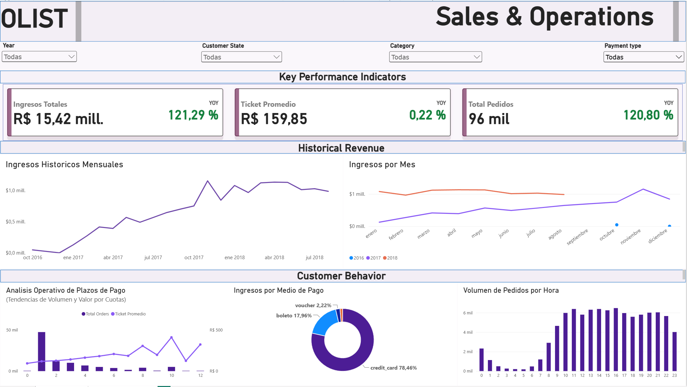
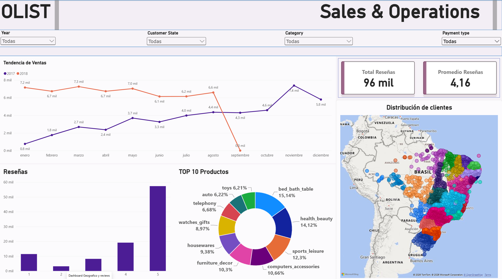

# Análisis de Rendimiento y Operaciones E-Commerce (Olist)

> **Resumen:** análisis de punta a punta de **96 mil pedidos** de Olist (R$ 15,42 millones en ingresos): limpieza y transformación con Python, consultas en PostgreSQL y dashboard interactivo en Power BI. El hallazgo central: **la logística, no los productos, es lo que más daña la satisfacción del cliente**. La reseña promedio cae de 4,29 a 2,57 estrellas cuando el envío llega tarde.

**Flujo del proyecto:** Python (ETL) → PostgreSQL → SQL (métricas) → Power BI (dashboard) → Reporte con recomendaciones.

## 📂 Origen de los Datos

El dataset público oficial puede descargarse directamente desde Kaggle:

* [Brazilian E-Commerce Public Dataset by Olist](https://www.kaggle.com/datasets/olistbr/brazilian-ecommerce)

## 🛠️ Herramientas Utilizadas

* **Python (Jupyter Notebook, Pandas, SQLAlchemy):** Procesamiento, limpieza y transformación de datos (ETL) y carga a PostgreSQL.
* **PostgreSQL / SQL:** Consultas relacionales, cálculo de métricas financieras y análisis de comportamiento.
* **Power BI:** Modelado de datos, creación de medidas DAX y desarrollo de dashboards interactivos.

## 🔄 Proceso ETL

El notebook [`Olist_ETL.ipynb`](Olist_ETL.ipynb) prepara los datos antes de cargarlos a la base:

* Carga de los CSV del dataset y traducción de las categorías de producto del portugués al inglés (con ajuste manual de las categorías sin traducción).
* Conversión de las columnas de fecha a `datetime` en pedidos, reseñas e ítems.
* **Productos:** se eliminaron los registros sin nombre de categoría y, para mantener la integridad referencial en PostgreSQL, también los 1.604 ítems de pedido que los referenciaban.
* **Geolocalización:** eliminación de duplicados y consolidación por prefijo de código postal (coordenadas promediadas), con ceros a la izquierda para unificar los prefijos a 5 dígitos.
* **Clientes:** se conservaron los 278 registros sin coincidencia de geolocalización.
* Se mantuvieron los nulos de pedidos y reseñas (por ejemplo, reseñas sin comentario), ya que no son errores de carga.
* Exportación de las 8 tablas finales a PostgreSQL: `products`, `orders`, `order_reviews`, `order_payments`, `order_items`, `geolocation`, `customers` y `sellers`.

## 🧮 Análisis SQL

El script [`consultas_Olist.sql`](consultas_Olist.sql) está organizado en tres bloques:

1. **Análisis financiero:** distribución y ticket promedio por método de pago, uso de cuotas, evolución mensual, ventas por día de la semana y por hora.
2. **Análisis geográfico:** ingresos, volumen y ticket promedio por estado; costo promedio de flete por estado.
3. **Rendimiento y rentabilidad:** top de categorías por ingresos y volumen, distribución de reseñas e impacto de las demoras en la satisfacción.

## 📊 Principales Hallazgos (Insights)

1. **Comportamiento financiero:** las tarjetas de crédito concentran casi el 74% de las órdenes y el mayor volumen de gasto; el boleto es el segundo método (19%). Existe una correlación directa entre más cuotas y mayor ticket promedio, con un pico inusual en 10 cuotas.
2. **Cuándo se compra:** los días de mayor conversión son de lunes a miércoles y las ventas caen hacia el fin de semana (el sábado es el punto más bajo). La mayor actividad ocurre de 10:00 a 16:00 hs, con un pico secundario entre las 20:00 y las 21:00.
3. **Categorías:** `bed_bath_table` concentra el mayor volumen de ventas, `health_beauty` lidera en ingresos y `watches_gifts` es la más rentable: ticket alto y grandes ingresos con la mitad del volumen de las líderes.
4. **Impacto geográfico y logístico:** São Paulo concentra la mayor parte del mercado (más de 40.000 pedidos), favorecido por un flete significativamente más barato (R$ 15,14 promedio). En las regiones periféricas el flete llega a duplicarse o casi triplicarse, lo que limita las compras a tickets elevados.
5. **Satisfacción del cliente:** la calificación promedio general es de 4,16 estrellas y el 77% de las reseñas son de 4 o 5. El problema está en las entregas: un envío a tiempo obtiene 4,29 estrellas; con retraso, el puntaje se desploma a 2,57.

## 💡 Recomendaciones

1. **Mantener las campañas de financiación larga** (especialmente 10 cuotas), que impulsan las compras de ticket alto.
2. **Concentrar la inversión publicitaria de lunes a miércoles, de 10:00 a 16:00 hs**, para maximizar el retorno.
3. **Auditar a los transportistas y ajustar la estimación de entrega** en la web: es preferible prometer un día más y cumplir, que prometer rápido y fallar.
4. **Diseñar una estrategia de envío gratis a partir de un monto mínimo** para los estados periféricos, donde los clientes ya compran tickets altos.

El detalle completo está en [`Reporte_Olist.pdf`](Reporte_Olist.pdf).

## 📁 Archivos del Proyecto

| Archivo | Descripción |
|---|---|
| [`Olist_ETL.ipynb`](Olist_ETL.ipynb) | Notebook con la limpieza, transformación y carga de los datos a PostgreSQL. |
| [`consultas_Olist.sql`](consultas_Olist.sql) | Consultas SQL para las métricas financieras, geográficas y de satisfacción. |
| [`Olist_Dashboard.pbix`](Olist_Dashboard.pbix) | Dashboard de Power BI (abrir con Power BI Desktop para usar los filtros). |
| [`Reporte_Olist.pdf`](Reporte_Olist.pdf) | Reporte final con conclusiones y recomendaciones. Se puede leer sin instalar nada. |
| [`images/`](images) | Capturas del dashboard. |

## ▶️ Cómo Reproducirlo

1. Clonar el repositorio y descargar el dataset de Kaggle en una carpeta `data/` (está en el `.gitignore`, no se sube al repo).
2. Instalar las dependencias: `pip install pandas sqlalchemy psycopg2-binary jupyter`.
3. Crear una base de datos en un PostgreSQL local y ajustar la conexión en la última sección del notebook. Usá variables de entorno para las credenciales y no las subas al repositorio.
4. Ejecutar `Olist_ETL.ipynb` para cargar las tablas.
5. Correr `consultas_Olist.sql` en pgAdmin (o tu cliente SQL) y abrir el dashboard en Power BI Desktop.
